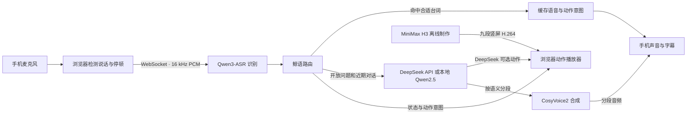

# 鲸语 · 二次元数字人

> DeepseekChan 还托着腮，你已经问了下一句。她可以直接接话，让眼前这段动作自然播完。

鲸语让你用自己的角色图、动作和音色搭一个能听、能说、能回应的二次元数字人。**MiniMax H3 负责角色表演**。它把角色图、姿态引导和动作描述变成能衔接的镜头。**DeepSeek API 可以担任实时中控**，听到新问题时组织回答，并从现有片段里选一个合适的动作。浏览器播放镜头，CosyVoice2 合成当下这句话。于是角色还在回正时，声音就能先接上。

[从 MiniMax H3 挥手工作流开始](workflows/README.md) · [配置 DeepSeek 中控](#选择中控) · [用普通电脑预览角色](#先在电脑上看见角色挥手)

**第一个已验证场景是手机浏览器视频电话。** 接通后可以围绕同一件事连续追问，也可以在角色说到一半时插话。一个实例同时服务一个通话席位。默认角色是 DeepseekChan。公开仓库提供可自行生成的示例机器人、动作工作流和通话代码，搭建自己的角色时需要准备角色素材、参考音色和模型权重。

## 下载 DeepseekChan 动作与工作流

[打开夸克项目分享目录](https://pan.quark.cn/s/fd7642532ef9) · 提取码 `Up9Z`（永久有效）

想先看效果，可以直接播放目录里的 18 秒动作预览。想在自己的电脑上试，把「01-鲸语源码与H3工作流.zip」和「02-DeepseekChan九组动作.zip」解压到同一目录，确认 `preview.py` 和 `.local` 在同一级，再运行 `python preview.py`。打开终端显示的本机地址，就能点选挥手、倾听、托腮思考等九组动作。动作预览无需下载模型权重。

## 角色由哪些部分组成

| 积木 | 使用的模型或代码 | 交给下一步的内容 |
|---|---|---|
| 表演 | MiniMax H3 Base Ref2VA 生成动作，Qwen3-VL-32B 编码参考图和动作描述 | 固定机位、首尾能衔接的动作片段，导入浏览器播放器 |
| 听觉 | 浏览器检测说话和停顿，Qwen3-ASR 转写 | 当前轮的文字送入鲸语路由 |
| 中控 | 鲸语先匹配明确预设。开放问题由 DeepSeek API 同时决定回答与动作，也可选择原有的本地 Qwen2.5 模式 | 命中时给出预设语音键。现答返回结合上下文的文字，DeepSeek 还可附一个动作名 |
| 声音 | 预设台词读取缓存，现答由 CosyVoice2 分段合成 | 可以连续播放的音频和逐句字幕所需的文本位置 |
| 动作与打断 | 浏览器动作调度器、音频播放器和轮次控制 | 新一轮可以立即停止旧回答，当前动作仍能在片段边界自然切换 |

想先看到效果，从下面的本地挥手示例开始。准备自己的形象可以直接看动作素材表，接模型前可先顺着一轮对话读懂接口。[换成自己的形象](#换成自己的形象) · [一通电话里的积木怎样拼起来](#一通电话里的积木怎样拼起来) · [在云实例上部署](#在云实例上部署)

## 先在电脑上看见角色挥手

```sh
git clone https://github.com/InariNGT-Ofiicial/jingyu-digital-human.git
cd jingyu-digital-human
python -m pip install Pillow
python avatar.py --demo
python preview.py
```

需要 Python 3.10+ 和带 libx264 编码器的 FFmpeg。把 `ffmpeg` 加入 PATH，或将 `FFMPEG` 环境变量设为可执行文件路径。打开 <http://127.0.0.1:18980/>，点「轻挥手」，等当前动作自然播完。示例机器人由代码在本机生成。这一步可以在普通电脑上运行。

## 一通电话里的积木怎样拼起来

拿“我想在窗边拍猫，站哪边好？……那我该拉一点窗帘吗？”举例。手机只传入声音；第二句话的“那”依靠前一轮对话才能理解。



1. **听到一句完整的话。** 浏览器请求回声消除，用播放参考信号辅助判断外放回声。麦克风重采样成 16 kHz 单声道 PCM。一次短暂停顿可以先触发识别草稿，说话继续就放弃相应的预答。最终提交时，Qwen3-ASR-1.7B-hf 把整句转成文字。输入键盘文字时从路由开始。[麦克风与判停](web/call.js) · [回声参考](web/duplex.js) · [服务端](server.py)
2. **决定用预设还是现答。** “挥挥手”命中台词库，服务端直接发回录音键和动作意图。问怎么拍猫、再追问窗帘时，DeepSeek 模式只在正式提交这一轮后，把文字与近期对话发到官方 API，一次取回 `reply`（朗读文本）和 `gesture`（可为空）。例如 `acknowledge` 让播放器在片段边界选择点头，冷却期间则继续自然待机。用户打断时，下一轮上下文只保留估计已听到的回答。挂断会结束这次会话的记忆。本地模式保留 Qwen2.5-1.5B-Instruct，也可显式启用 JEV 做预设匹配。[DeepSeek 中控](deepseek_controller.py) · [台词库](dialogue-bank.json) · [上下文](phone_context.py)
3. **把回答说出来。** 预设走缓存 WAV。现答按语义切成可连续朗读的短句，电话进程逐段请求合成服务的 `POST /speak`。CosyVoice2-0.5B 结合文字与参考音色生成语音符号，Flow 生成声学特征，HiFT 声码器输出 24 kHz 波形。服务端用 `voice_part` 把音频和对应的累计字符位置送回浏览器，手机一边播放前段，一边接收后段。字幕根据音频播放时钟在底部逐句显示。[合成服务](synthesis.py) · [播放与字幕](client.js)
4. **让动作接得上。** 准备素材时，Qwen3-VL-32B 编码参考图和动作描述。H3 Ref2VA 配合 Turbo v4 LoRA 先用四步看动作，二采读回缓存、做三维潜空间放大和十二步细化，再由视频 VAE 解码。当电话接通，浏览器根据倾听、思考、说话等状态和重复间隔选择现有片段。角色还在前倾时声音就能接入，画面在片段边界转场。当前路线使用动作片中的面部表情，逐字口型未同步。[H3 工作流](workflows/README.md) · [动作策略](web/motion-policy.json) · [调度器](web/motion-director.js)
5. **插话之后接着聊。** 确认来电者开始说话时，浏览器停止旧音频并清空字幕，通知服务器切换轮次；旧轮迟到的结果会被丢弃。已经开始播放的分段用于估算已听到的文字范围，下一轮根据这段上下文接话。复盘里的“末音到首声”是浏览器估算，受判停、模型、网络和播放设备影响。[通话协议处理](server.py) · [打断测试](tests/test_interrupted_dialogue.py)

## 换成自己的形象

1. 在 `character.json` 填角色呼号。准备一张正视来电图和九段相同机位、相同画幅的动作。首尾使用同一个回正姿势，前后片段才能自然衔接。
2. 素材目录中按下表命名 MP4，执行 `python avatar.py --clips "/path/to/my-clips" --poster "/path/to/front.png"`。命令会在本地数据目录生成桌面、手机和首播版本。再次打开预览，分别点选每个动作。
3. 在 `dialogue-bank.json` 修改台词、别名和关联动作。`web/motion-policy.json` 控制状态可选动作和最短重复间隔。更换呼号或改词后重新生成预设语音。更换参考音色时执行 `python prepare_lines.py --refresh`。

| 动作 | MP4 文件名 | 动作 | MP4 文件名 |
|---|---|---|---|
| 正视呼吸 | front-breathe.mp4 | 舒展肩膀 | h3-shoulders.mp4 |
| 整理领结 | h3-ribbon.mp4 | 点头 | acknowledge.mp4 |
| 看消息 | read-request.mp4 | 挥手 | wave.mp4 |
| 倾听 | listen.mp4 | 托腮思考 | think.mp4 |
| 浅笑 | smile.mp4 | | |

已有视频可以直接导入。要自己生成动作，先在云端 ComfyUI 提交 MiniMax H3 首采，再用同一份潜变量做二采，把导出的 MP4 作为 `wave.mp4` 导入。仓库附有这条挥手工作流的两份可执行 JSON，其他动作按各自姿势和描述制作。[MiniMax H3 工作流与模型来源](workflows/README.md)

## 接入语音和对话

原项目实测的参考部署为 Linux、NVIDIA 48 GB vGPU、CUDA 12.8 和 PyTorch 2.8.0。动作预生成与电话服务可以分时运行，通话阶段直接解码 H.264。模型、参考声音和角色素材由搭建者自行准备。

| 模型 | 实际职责 | 默认目录 |
|---|---|---|
| [Qwen3-ASR-1.7B-hf](https://huggingface.co/Qwen/Qwen3-ASR-1.7B-hf) | 将浏览器的 16 kHz 单声道语音转成文字 | .local/models/asr |
| [DeepSeek API](https://api-docs.deepseek.com/) | 在线中控，接收转写与近期文字上下文，同时给出回答和可选动作 | 服务端环境变量，无需下载对话权重 |
| [Qwen2.5-1.5B-Instruct](https://huggingface.co/Qwen/Qwen2.5-1.5B-Instruct) | 本地中控，判断短句是否适合预设，为连续追问生成带上下文的回答 | .local/models/decision |
| [CosyVoice2-0.5B](https://huggingface.co/FunAudioLLM/CosyVoice2-0.5B) | 从文字、参考音色生成 24 kHz 语音，整句按语义分段衔接播放 | .local/models/cosyvoice |

### 选择中控

要使用 DeepSeek，在电话和语音进程的环境中都设置 `JINGYU_CONTROLLER=deepseek`。只有运行 `server.py` 的进程需要密钥。在它的 Bash 终端按下面的方式输入，输入内容不会显示在屏幕或命令历史中。

```bash
export JINGYU_CONTROLLER=deepseek
read -rsp 'DeepSeek API key: ' DEEPSEEK_API_KEY && echo
export DEEPSEEK_API_KEY
```

服务端以 `deepseek-flash` 请求 `https://api.deepseek.com/chat/completions`，关闭思考模式并要求 JSON 输出。可用 `JINGYU_DEEPSEEK_MODEL` 指定账户支持的模型。上行内容为确认过的文字和对话上下文，麦克风音频交给实例本地的 ASR。请求超时或密钥、额度异常时，界面显示原因。使用本地 Qwen2.5 时，两个进程都设置 `JINGYU_CONTROLLER=local`。省略设置时，有密钥的进程选择 DeepSeek，其余进程选择本地模式。[模型与调用方式](https://api-docs.deepseek.com/) · [JSON 输出](https://api-docs.deepseek.com/guides/json_mode/)

### 在云实例上部署

从云平台控制台开机，复制该实例的 SSH 登录命令。登录后运行 `nvidia-smi` 查看显存和驱动，运行 `df -h` 确认数据盘挂载。在 AutoDL 上，常见数据盘是 `/root/autodl-tmp`。在挂载的数据盘中检出本仓库，再执行下面的安装命令。已有九段动作可以直接导入；同卡制作 H3 动作时，先让生成任务结束并释放模型，再启动电话模型。

```sh
# AutoDL 示例，其他平台替换为实际数据盘挂载点
cd /root/autodl-tmp
git clone https://github.com/InariNGT-Ofiicial/jingyu-digital-human.git
cd jingyu-digital-human
```

在 Linux 上单独准备两个 Python 环境。电话环境使用 Transformers 5.16.1，语音环境使用 Transformers 4.51.3。以下命令从仓库根目录执行，`python3.10` 也可换成兼容的解释器。

```sh
python3.10 -m venv .local/call-env
.local/call-env/bin/pip install torch==2.8.0 torchaudio==2.8.0 --index-url https://download.pytorch.org/whl/cu128
.local/call-env/bin/pip install -r requirements-call.txt
.local/call-env/bin/hf download Qwen/Qwen3-ASR-1.7B-hf --local-dir .local/models/asr
.local/call-env/bin/hf download FunAudioLLM/CosyVoice2-0.5B --local-dir .local/models/cosyvoice
git clone --recursive https://github.com/FunAudioLLM/CosyVoice.git .local/CosyVoice
git -C .local/CosyVoice checkout 074ca6dc9e80a2f424f1f74b48bdd7d3fea531cc
git -C .local/CosyVoice submodule update --init --recursive
```

本地中控还需下载 Qwen2.5。使用 DeepSeek 中控时可直接准备下面的语音环境。

```sh
.local/call-env/bin/hf download Qwen/Qwen2.5-1.5B-Instruct --local-dir .local/models/decision
```

按 [CosyVoice 安装说明](https://github.com/FunAudioLLM/CosyVoice/tree/074ca6dc9e80a2f424f1f74b48bdd7d3fea531cc) 配好独立语音环境，包括 Matcha-TTS、语音前端与 CUDA 版 PyTorch。确认该环境能用 `CosyVoice2-0.5B` 生成一段声音，然后安装 `aiohttp==3.12.15`、`transformers==4.51.3`。把一段有权使用的人声 WAV 放到 `.local/reference.wav`。

离线运行时，从 [WeText 规则库](https://modelscope.cn/models/pengzhendong/wetext) 取得 `zh/tn` 和 `en/tn` 下的 `tagger.fst`、`verbalizer.fst`，保留相对目录放入 `.local/models/wetext`。已有规则可设置 `JINGYU_WETEXT`。这样首次启动就能直接加载中英文规范化规则。

按顺序启动。下表中的 Python 分别指相应环境里的解释器。第一个和第三个进程保持运行。

| 顺序 | 环境和命令 | 成功时看到 |
|---|---|---|
| 1 | 语音环境：`python synthesis.py` | 预热后输出 READY，语音与快速回答服务监听本机 18983 |
| 2 | 电话环境：`python prepare_lines.py` | 本地生成台词 WAV 和校验清单 |
| 3 | 电话环境：`python server.py` | 输出 READY，在电脑打开 <http://127.0.0.1:18982/> |

语音合成采用与演示相同的 CosyVoice 2 链路，实际音色取决于参考录音和 `JINGYU_VOICE_STYLE`。已有权重可设置 `JINGYU_ASR`、`JINGYU_DECISION`、`JINGYU_COSY_MODEL`、`JINGYU_COSY_SOURCE`、`JINGYU_VOICE_REFERENCE` 指向本机路径。自定义数据目录用 `JINGYU_DATA`。设置和默认值见 [settings.py](settings.py)。运行前请完成动作导入或生成示例。

## 手机接听和验收

1. 在本机数据目录 `.local/mobile-origin.txt` 中写一行自己的 HTTPS 源地址，例如 `https://call.example.org`，结尾不带斜杠。重启 `server.py`，它会生成 `.local/mobile-invite`。
2. 将该 HTTPS 源反向代理到 `127.0.0.1:6006`，启用 WebSocket 升级，保留原浏览器 Origin。18982 和 18983 只供本机使用。手机访问 `https://call.example.org/#你的邀请码`，允许麦克风后接听。
   使用云平台自定义服务时，填写控制台分配的完整 HTTPS 源（含非标准端口）。自管域名且 Caddy 与电话服务位于同一台机器时，可使用下面的 Caddyfile 配置。域名要指向这台服务器，入口应能正常提供 HTTPS。

   ```caddyfile
   call.example.org {
       reverse_proxy 127.0.0.1:6006
   }
   ```

3. 围绕同一主题连续追问，在角色回答时开口插话。挂断后进入「通话复盘」查看识别文本、末音到首声的逐轮估算和打断次数。录音、实际网络、浏览器和 GPU 都影响延迟。

只开动作预览和运行文本逻辑测试均无需 GPU。运行测试可执行 `python -m unittest discover -s tests`。

## 项目来源与许可

鲸语数字人的代码从鲸语 Live2D 仓库的数字人分支独立出来。VoxEMW 是早期研究实时数字人时参考的项目，本仓库采用 H3 预生成二次元表演与鲸语实时对话编排。[鲸语原始源码快照](https://github.com/InariNGT-Ofiicial/jingyu-live2d-agent/tree/09ec496a341757b15d04c21d407af5fcbc50ba32/digital-human) · [VoxEMW](https://github.com/emwstudio/VoxEMW)

代码使用 MIT 许可证，模型及自行导入的角色素材遵循各自许可。[MIT 许可证](LICENSE.txt)
